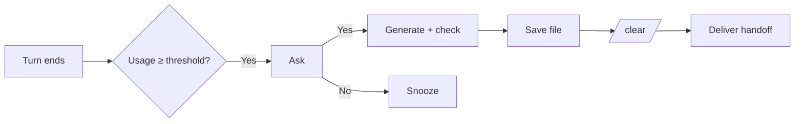

# Context Baton

**Ask-first context handoff for Claude Code.** When your context reaches the percentage you choose, Context Baton (Baton for short) asks if you want to hand off. Say yes and it writes a handoff document, starts a fresh session, and delivers the handoff to it. You type nothing else.


<p align="center">
  
</p>

## What it does

| When | What happens | You do |
|---|---|---|
| **A turn ends and context ≥ your threshold** (default 40%) | Baton asks: *"Context is at 41%. Hand off and continue in a new session?"* | Pick Yes or No |
| **You pick Yes** | It generates a ten-section handoff, checks it, saves it as a file, runs `/clear`, and submits the handoff. The new session summarises what it understood and waits for you. | Nothing |
| **You pick No** (or press Esc) | Nothing changes. Baton asks again after usage grows another 10 points. | Nothing |
| **Something fails** | The session is only cleared after the handoff is saved. An undelivered handoff is kept. | `/baton resend` |

Your previous session is never deleted: `claude --resume <id>` brings it back.



## Quick start

Requires Claude Code with mods (on by default from 2.1.287). Tested on 2.1.295. Check with `claude --version`.

```bash
claude plugin marketplace add sampaio-arthur/context-baton
claude plugin install context-baton@context-baton
```

If the install prints "3 userConfig options not yet set", that is informational; the defaults apply.

Or try it for one session from a clone:

```bash
git clone https://github.com/sampaio-arthur/context-baton
claude --plugin-dir ./context-baton
```

Start Claude Code in your project, send a message, and run `/baton`. You should see something like this (Claude Code attributes each line to the `context-baton` plugin; how it marks that depends on the interface):

```text
Context: 5% (46,405 of 1,000,000 tokens) · threshold 40% (not reached)
Settings: threshold 40%, snooze 10 points, handoff folder .claude/handoff
```

## Commands

You do not need these in the normal flow.

| Command | Purpose |
|---|---|
| `/baton` | Status: usage, threshold, snooze, saved documents, last handoff or failure |
| `/baton now` | Hand off right now, without asking |
| `/baton dry` | Generate and show a handoff; no document is written and nothing is cleared |
| `/baton resend` | Deliver a handoff that was saved but did not arrive |

## Configuration

Change settings in `/config`: find Baton's settings there. They persist across sessions.

| Setting | Default | Range | Meaning |
|---|---|---|---|
| Handoff threshold (%) | `40` | 10–90 | Context usage at which Baton asks |
| Snooze after No (points) | `10` | 1–50 | Growth required before asking again |
| Handoff folder | `.claude/handoff` | inside the project | Where documents are saved |

Baton measures **context-window usage**, the figure shown by `/context`. It is unrelated to plan usage or rate limits.

## The handoff

Each handoff is saved as `<handoff folder>/<session-id>.md`, written in the language you write in:

| # | Section | # | Section |
|---|---|---|---|
| 1 | Goal | 6 | Still running or unfinished |
| 2 | Standing instructions | 7 | Decisions |
| 3 | Verified | 8 | Key files and commands |
| 4 | Done but not verified | 9 | Next step |
| 5 | Failed approaches | 10 | Open questions |

- Standing instructions and decisions hold only what **you** said, near-verbatim.
- The model is told never to claim a test passed or a file changed unless the conversation shows it.
- Baton checks that all ten sections exist, retries once, and stops without clearing anything if the document is still incomplete.

## Limitations

- **Pre-release, built on a new API.** A Claude Code update may require a Baton update.
- **Tested on Windows 11 with PowerShell, Claude Code 2.1.295.** macOS, Linux, the Desktop app, and the VS Code chat panel are not tested. The CLI in VS Code's integrated terminal is expected to behave like any terminal.
- **Documents are never deleted automatically.** Remove old ones yourself.
- **Only text is carried over** from messages typed during a handoff; attachments are not.
- **The check is structural.** It confirms the sections exist, not that their content is right. Use `/baton dry` to read a handoff.

## What Baton does on your machine

A mod runs inside Claude Code with your permissions. This is all Baton does with them:

- **Writes** only handoff documents: `<handoff folder>/<session-id>.md`, or `~/.baton/handoff/<session-id>.md` when the handoff folder would be inside Claude Code's own folder or the project is inside a system folder. The name must look like a session id (letters, digits, `-`, `_`) and always ends in `.md`. Baton never writes a build, start-up, settings or instructions file; a handoff folder inside `.claude/commands`, `agents`, `skills`, `rules` or `output-styles` is refused. Its other state lives in the plugin store Claude Code keeps for it.
- **Reads no files and lists no folders.** It only writes handoff documents. It reads seven environment variables to place that folder: `USERPROFILE`, `HOME`, `CLAUDE_CONFIG_DIR`, `SystemRoot`, `WINDIR`, `ProgramFiles`, `ProgramFiles(x86)`.
- **Prompts it submits:** the handoff text, the messages you typed during the handoff, and a fixed intro line with the reason and the document's path filled in. Nothing read from other files.
- **Slash commands it runs:** only `/clear`, and only after you answer "Yes" or run `/baton now`. `/baton resend` never clears.
- **Hooks:**
  - `classic.Stop`: when a turn ends, checks usage against your threshold and, if due, asks Yes or No.
  - `prompt.submit`: while a handoff runs, holds what you type and delivers it to the new session; otherwise passes messages through unchanged.
  - `command.run`: answers `/baton` (or `/baton-handoff`): status, `now`, `dry`, `resend`.
  - `session.start`: registers `/baton`, removes its own store entries older than 30 days, and reports bad settings, an undelivered handoff, or a redirected folder.
  - `session.end`: if the session ends during a handoff (other than by `/clear`), stops the handoff before `/clear`, keeping the document.

The handoff itself is written by a fork of the conversation (one model call, two if the first document is incomplete). Baton makes no other network requests, runs no external processes, and collects no telemetry. Details: [Guide, Security and privacy](./docs/GUIDE.md#security-and-privacy).

## More

- [Guide](./docs/GUIDE.md): full behaviour, failure and recovery table, troubleshooting, Windows notes, FAQ
- [Manual checks](./tests/MANUAL.md)
- [Privacy](./PRIVACY.md): what the plugin stores and where

## Development

```bash
claude plugin validate .
claude plugin test .
npx -p typescript tsc -p .
```

## Credits

Derived from [ctx-handoff-mod](https://github.com/cablate/ctx-handoff-mod) by cablate (MIT), which provides the handoff engine. The completeness check follows [claude-handoff](https://github.com/samzilverberg/claude-handoff) by Sam Zilverberg (MIT).

## License

[MIT](./LICENSE)