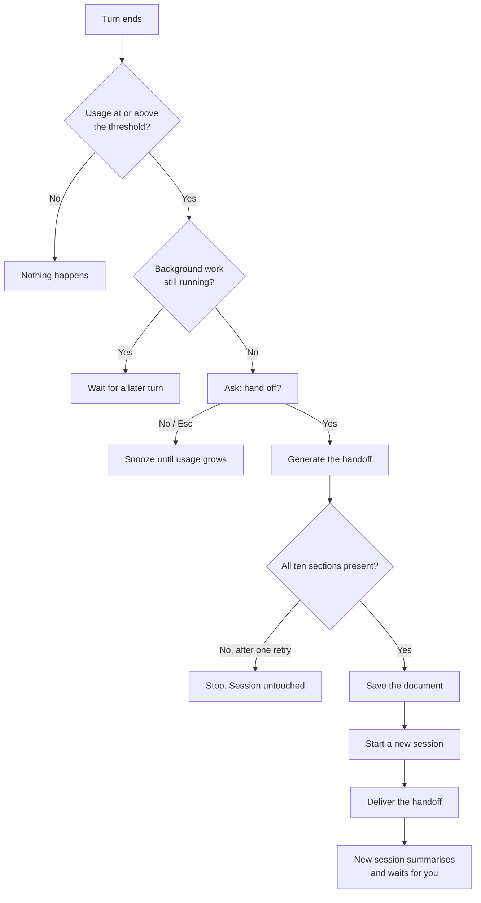

# Context Baton guide

**Ask-first context handoff for Claude Code.**

When your context window reaches a percentage you choose, Context Baton (Baton for short) asks if you want to hand off. Say yes and it writes a structured handoff document, starts a fresh session, and delivers the handoff to it. You type nothing else.


> **Pre-release.** Baton is built on Claude Code's mods API, which is recent and may change between releases. See [Compatibility](#compatibility) for what has been tested.

## Contents

- [Why](#why)
- [What it looks like](#what-it-looks-like)
- [Quick start](#quick-start)
- [How it works](#how-it-works)
- [Configuration](#configuration)
- [Commands](#commands)
- [The handoff document](#the-handoff-document)
- [FAQ](#faq)
- [Troubleshooting](#troubleshooting)
- [Compatibility](#compatibility)
- [Security and privacy](#security-and-privacy)
- [Known limitations](#known-limitations)
- [Contributing](#contributing)
- [Credits](#credits)

## Why

Long sessions get worse before they get full. Auto-compact fires late, in the middle of a turn, and its summary tends to drop decisions and standing instructions. Other handoff tools either switch without asking or leave the last steps (`/clear`, paste, resume) to you.

Baton combines three things:

- **A percentage threshold.** You choose the point, for example 40% of the window.
- **Consent first.** It asks at the end of a turn, never in the middle of one. Anything but "Yes" means no.
- **An automatic switch.** After a yes, the document, the new session, and the delivery happen on their own.

## What it looks like

An illustration (the layout of the dialog and the model's reply will differ). At the end of a turn, once usage reaches your threshold:

```text
Context is at 41%. Hand off and continue in a new session?
  1. Yes
  2. No
```

Choose **Yes** and the rest is automatic:

```text
handoff saved to .claude/handoff/5d5c9ead-….md

> /clear

› Prompt from the context-baton plugin
  [baton] The previous conversation was cleared automatically because context
  reached 41% of the window and the user agreed to hand off. Here is the handoff: …

● I read the handoff. Current state: the parser refactor is done and its tests
  pass; the CLI flags are next. Waiting for your instructions.
```

Choose **No** and nothing happens. Baton asks again only after usage has grown by another 10 points.

## Quick start

**1. Check your version.** Baton requires Claude Code with mods (on by default from 2.1.287). It has been tested on 2.1.295.

```bash
claude --version
```

**2. Install.**

```bash
claude plugin marketplace add sampaio-arthur/context-baton
claude plugin install context-baton@context-baton
```

The install may print "3 userConfig options not yet set". That message is informational; the defaults apply.

Prefer to try it first? Load it for a single session from a clone:

```bash
git clone https://github.com/sampaio-arthur/context-baton
claude --plugin-dir ./context-baton
```

**3. Verify.** Start Claude Code in your project, send any message, then run:

```text
/baton
```

You should see your context usage, the current settings, and the command list. Each line is shown as a message from the `context-baton` plugin, and how the interface marks that varies:

```text
Context: 5% (46,405 of 1,000,000 tokens) · threshold 40% (not reached)
Settings: threshold 40%, snooze 10 points, handoff folder .claude/handoff
Latest handoff: none
Background (last Stop): 0 tasks, 0 one-off schedules, 0 recurring schedules
Usage:
  /baton           status
  /baton now       create a handoff, /clear, and send it to the new session
  /baton dry       trial handoff, no /clear
  /baton resend    resend a handoff that did not arrive (no /clear)
```

**4. Set your threshold (optional).** Run `/config`, find Baton's settings, and change **Handoff threshold (%)**. The default is 40.

That is all. Keep working; Baton will ask when the time comes.

## How it works



- **Nothing is cleared until the handoff is safe.** The document is validated and saved before the session switches. If anything fails earlier, you stay where you were.
- **Your old session is kept.** The switch creates a new session in the same terminal. The previous one stays on disk; `claude --resume <id>` brings it back.
- **It is cheap.** The handoff is generated from a fork of the conversation, which reads the existing prompt cache and adds no turn to your session. In our tests on short sessions it took 3.5–8.9 seconds.
- **Messages are not lost.** Anything you type while a handoff is in progress is held and delivered to the new session with it (text only).
- **No nagging.** A session created by a handoff does not ask again right away, and background tasks or subagents are allowed to finish first (up to 90% usage).

## Configuration

| Setting | Default | Range | What it does |
|---|---|---|---|
| Handoff threshold (%) — `thresholdPercent` | `40` | 10–90 | Context usage at which Baton asks |
| Snooze after No (points) — `snoozePoints` | `10` | 1–50 | After a "No", how many percentage points usage must grow before Baton asks again |
| Handoff folder — `handoffDir` | `.claude/handoff` | a folder inside the project, not inside `.claude/commands`, `agents`, `skills`, `rules` or `output-styles` | Where handoff documents are saved |

The main way to change them is `/config`: find Baton's settings there. Values persist across sessions.

You can also edit your user settings file, `~/.claude/settings.json`. For a marketplace install the key is `context-baton@context-baton`:

```json
{ "pluginConfigs": { "context-baton@context-baton": { "options": { "thresholdPercent": 30 } } } }
```

A copy loaded with `--plugin-dir` uses the key `context-baton` instead.

Good to know:

- A threshold between 30 and 40 is a reasonable start for long development sessions.
- An out-of-range value falls back to its default. Baton tells you once at session start and in `/baton`.
- Write numbers without quotes. `"30"` in quotes stops Claude Code from loading the plugin.
- Settings are per user. Project settings files are not read for plugin options.
- Baton measures **context-window usage of the current session**, the same figure as `/context`. It is unrelated to plan usage, rate limits, or weekly quotas.

## Commands

You do not need any of these in the normal flow.

| Command | What it does |
|---|---|
| `/baton` | Shows context usage, threshold, snooze or pause state, waiting for background work, settings, saved documents, and the latest handoff or failure |
| `/baton now` | Hands off immediately, without waiting for the threshold or asking |
| `/baton dry` | Generates and shows a handoff. It writes no document and clears nothing (it records the run's metadata in Baton's store) |
| `/baton resend` | Delivers a handoff that was saved but did not reach a session |

If `/baton` is already taken, Baton registers `/baton-handoff` instead and says so.

The answers of `/baton`, `/baton now`, and `/baton resend` are shown in the terminal only and are not sent to the model. The output of `/baton dry` is the document itself and does enter the conversation.

## The handoff document

Each handoff starts with `HANDOFF: <one-sentence goal>` and has ten numbered sections:

| # | Section | Content |
|---|---|---|
| 1 | Goal | What you actually asked for |
| 2 | Standing instructions | Every directive you gave, near-verbatim, tagged `[active]` or `[superseded]` |
| 3 | Verified | Checks that were actually run, with their results |
| 4 | Done but not verified | Changes not yet checked, and conclusions based on inference |
| 5 | Failed approaches | What was tried and did not work, and why |
| 6 | Still running or unfinished | Background processes, unsaved changes, temporary files |
| 7 | Decisions | Decisions made with you, and why |
| 8 | Key files and commands | Relevant paths and commands |
| 9 | Next step | One concrete action |
| 10 | Open questions | Questions waiting for you |

What to expect from it:

- **Your language.** The document is written in the language you write in, section titles included.
- **Only what you said.** Sections 2 and 7 hold your own directives and decisions. System prompts, `CLAUDE.md`, and tool instructions are left out; the new session loads those again by itself.
- **No unearned claims.** The model is told never to say a test passed or a file changed unless the conversation shows it. Anything unproven goes under section 4.
- **No guessed file names.** The document does not name its own file or session; Baton adds the real path when it delivers it.
- **Checked before the switch.** Baton verifies that all ten sections are present, retries once if not, and stops without clearing anything if the second attempt is also incomplete. The check is structural; use `/baton dry` to read a handoff yourself.

### Where documents are saved

- `<handoff folder>/<session-id>.md`, inside your project. The new session is told the path.
- Documents go to `~/.baton/handoff/` instead when the handoff folder would land inside Claude Code's config folder (`~/.claude`, or `CLAUDE_CONFIG_DIR` if set), which happens with the default folder when the project is your home folder, or when the project is inside a system folder (the Windows folder or Program Files). Baton tells you when this happens, at session start and in `/baton`.
- **Baton never deletes documents.** `/baton` shows how many are saved; remove old ones when you no longer need them.
- Documents are UTF-8. In Windows PowerShell 5.1, read them with `Get-Content <file> -Encoding UTF8`.
- Consider adding the handoff folder to `.gitignore`.

## FAQ

**Is this the same as compaction?**
No. Compaction summarises inside the same session. Baton writes a document you can read, starts a new session, and keeps the old one intact.

**Will I lose my conversation?**
No. The previous session stays on disk and can be reopened with `claude --resume <id>`. The handoff document is also saved as a file.

**What does a handoff cost?**
One model call, mostly served from the prompt cache. In our tests on short sessions, 67.89–98.33% of the input was read from cache and generation took 3.5–8.9 seconds. A second call happens only if the first document is incomplete.

**What if I say no?**
Nothing changes. Baton asks again after usage grows by the snooze amount (10 points by default).

**Can it switch without asking?**
Only when you run `/baton now` yourself. The automatic path always asks first, and only an exact "Yes" hands off.

**Why did it not ask even though I am above the threshold?**
Run `/baton`. It will say whether you are snoozed after a "No", paused after a failed handoff, or waiting for background work to finish.

**Does it work in the VS Code extension?**
Not tested. The CLI in the integrated terminal is expected to behave like any terminal.

**What happens if I close the terminal or exit during a handoff?**
- If you exit before the document is saved, the old session is intact and can be resumed (tested by hand).
- Later exits are covered by automated tests: Baton does not clear, keeps the document and the pending handoff, and the next session in the same project tells you an undelivered handoff exists; `/baton resend` delivers it.
- If the process is killed between writing the document and storing the pending entry, only the file remains, and there is no notice.

## Troubleshooting

| Symptom | Likely cause | What to do |
|---|---|---|
| `/baton` is not recognised | The plugin did not load | Accept workspace trust for the folder, then restart Claude Code. On the very first launch after installing, a second start may be needed. |
| Baton stopped loading after I edited settings | A setting has the wrong type | Write numbers without quotes in `pluginConfigs` |
| `/baton` shows `not measured yet` | No turn has finished in this session | Send a message first |
| The question never appears | Usage is below the threshold, or Baton is snoozed, paused, or waiting | Run `/baton` and read the status lines |
| `Handoff failed: no handoff was generated` | Nothing to fork yet (just started or just cleared) | Send a message, wait for the reply, try again |
| `Handoff failed: the document could not be saved` | The handoff folder cannot be created | Fix the folder or change the **Handoff folder** setting |
| `Handoff made but not delivered` | The new session did not receive it | Run `/baton resend` |
| `handoff not delivered: the session changed` | You ran `/clear` or `/resume` during the handoff | Run `/baton resend` |
| Accented characters look wrong on Windows | PowerShell 5.1 does not read UTF-8 by default | `Get-Content <file> -Encoding UTF8` |
| `claude -p "/baton"` does nothing in Git Bash | Git Bash rewrites arguments that start with `/` | Use PowerShell, or `MSYS_NO_PATHCONV=1 claude -p "/baton"` |

After a failed handoff (a real one, not `/baton dry`), Baton waits for 3 more messages or 10 minutes before asking again. `/baton now` works at any time.

For details, start Claude Code with `--debug-file <path>` and search the log for `[baton]`.

## Compatibility

| Environment | Status |
|---|---|
| Claude Code CLI, Windows 11, PowerShell (v2.1.295) | Tested |
| Claude Code CLI, macOS or Linux | Not tested yet |
| Claude Desktop app, Code tab | Not tested yet |
| VS Code extension chat panel | Not tested. The CLI in the integrated terminal is expected to behave like any terminal. |
| `claude -p` (print mode) | The question cannot be shown; Baton treats that as "No". `/baton now` works. |
| claude.ai in the browser, Claude Desktop chat | Not supported. Plugins have no access to context or sessions there. |

Reports from other platforms are welcome. Please open an issue with your OS, terminal, and Claude Code version.

## Security and privacy

A mod runs inside Claude Code with your permissions. This is everything Baton does with them:

- **Reads** context usage, the session id and project folder, the number of prompts you have sent (for the pause after a failed handoff), the state of background tasks and subagents, and seven environment variables used to place the handoff folder: `USERPROFILE`, `HOME`, `CLAUDE_CONFIG_DIR`, `SystemRoot`, `WINDIR`, `ProgramFiles`, `ProgramFiles(x86)`.
- **Reads one file**, `<project>/.git`. In a git worktree that file names the main repository, so all worktrees of one repository share their handoff history and undelivered handoffs. In a normal repository `.git` is a folder; the read fails and is ignored. Baton never reads a handoff document back, or any other file.
- **Lists** the handoff folder, to show in `/baton` how many `.md` documents it holds.
- **Writes** exactly one kind of file: `<handoff folder>/<session-id>.md`, or `~/.baton/handoff/<session-id>.md` when redirected (see [Where documents are saved](#where-documents-are-saved)). The code refuses a session id that is not letters, digits, `-` and `_` (at most 128 characters), so the file can neither leave the folder nor get another extension, and the handoff folder setting must stay inside the project and outside the folders Claude Code loads commands, agents, skills, rules and output styles from. It never writes a build, start-up, settings or instructions file.
- **Stores** small entries in its own plugin store (pending handoffs, snooze marks, the latest handoffs and failure). Session entries are removed after 30 days.
- **Asks** with Claude Code's own question dialog.
- **Calls the model** once per handoff, twice if the first document is incomplete, on your own plan or API key. The call is a fork of the conversation with a fixed prompt asking for the ten-section document.
- **Submits** the handoff text, the messages you typed during the handoff, and a fixed intro line (with the reason, for example the percentage, and the document's path filled in). If a handoff fails before `/clear`, held messages go back to the old session as you typed them; if it fails after, they are added to the pending handoff for `/baton resend`. Nothing read from a file is submitted.
- **Runs** `/clear`, only after you answer "Yes" or run `/baton now`, and only once the document is saved. `/baton resend` submits a saved handoff without clearing.

Hooks it registers:

| Hook | What it does |
|---|---|
| `classic.Stop` | At the end of a main-conversation turn (not a subagent's, and not when another Stop hook continues the turn): records background work, compares usage with the threshold, snooze and pause, waits while background work runs, and when due asks Yes or No. |
| `prompt.submit` | While a handoff runs, holds the text you type and delivers it with the handoff (slash commands pass through). Otherwise passes every message unchanged, with a one-time reminder if a handoff was not delivered. On failure the message goes through unchanged. |
| `command.run` | Answers `/baton` or `/baton-handoff`: status, `now`, `dry`, `resend`. |
| `session.start` | Registers `/baton` (or `/baton-handoff`), removes its own session entries older than 30 days, and reports rejected settings, an undelivered handoff of this project, and a redirected handoff folder. |
| `session.end` | When the session ends during a handoff for any reason but `/clear` (exit, closed terminal, another session resumed), makes the handoff stop before `/clear` and submit, keeping the document and the pending text for `/baton resend`. |

It makes no other network requests, runs no external processes, and collects no telemetry. You can list what any mod does before installing it:

```bash
claude plugin validate <path-to-plugin>
```

Avoid running Claude Code from an administrator shell. Plugins inherit those permissions.

## Known limitations

- The mods API is new; a Claude Code update may require a Baton update.
- Documents are never deleted automatically.
- Images and other attachments sent during a handoff are not carried over; only text is.
- The handoff check is structural. It confirms the sections exist, not that their content is right.
- Some host applications reopen the old session id after an in-process `/clear`. Baton does not guard against that.
- The pause after a failed handoff is kept in memory, so a plugin reload ends it early.

## Contributing

Issues and pull requests are welcome.

```bash
claude plugin validate .
claude plugin test .
npx -p typescript tsc -p .
```

- `tsc` needs the type definitions that Claude Code writes to `.claude-plugin/types/` the first time it loads the plugin in an interactive session (`claude --plugin-dir .`).
- Pure logic lives in `src/` with tests in `tests/`. Every call to the mods API lives in `hooks/register.ts`.
- Checks that need a real session are listed in [tests/MANUAL.md](../tests/MANUAL.md).

**Seeing the question without filling a large window.** On accounts where every model has a 1M-token window, even a 10% threshold needs about 100k tokens. For testing, start a session with a 200k window and a low threshold:

```powershell
'{ "pluginConfigs": { "context-baton": { "options": { "thresholdPercent": 10 } } } }' | Set-Content "$HOME\baton-test-settings.json"
$env:CLAUDE_CODE_DISABLE_1M_CONTEXT = "1"
claude --plugin-dir . --settings "$HOME\baton-test-settings.json" --model haiku
```

This loads Baton with `--plugin-dir`, so the settings key is `context-baton`; for a marketplace install use `context-baton@context-baton`. The question then appears at the end of the first turn. Remove the variable afterwards with `Remove-Item Env:CLAUDE_CODE_DISABLE_1M_CONTEXT`. This variable was observed in Claude Code 2.1.295 and may not be officially documented.

## Credits

Baton is derived from [ctx-handoff-mod](https://github.com/cablate/ctx-handoff-mod) by cablate (MIT), which provides the engine: fork-based generation, the pending submit, `/clear` and submit, held messages, resend, and the handoff format Baton extends. The section-completeness check with a bounded retry follows [claude-handoff](https://github.com/samzilverberg/claude-handoff) by Sam Zilverberg (MIT).

## License

[MIT](../LICENSE)
